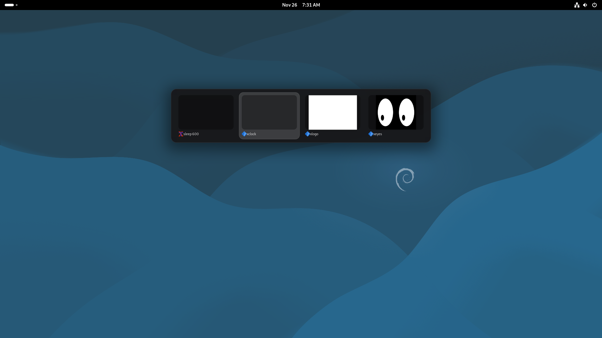

# Z-Order Alt-Tab

**English** | [简体中文](#z-order-alt-tab-简体中文)

A GNOME Shell extension that switches windows in true **stacking (z) order**,
instead of the "most recently used + grouped by application" order used by the
default switcher.



Every window is a peer. The popup shows one thumbnail card per window, ordered
by stacking position with the topmost window first. Alt+Tab walks down that
list; releasing Alt activates the selected window, which then rises to the top
of the stack.

## Switching model

Starting from the stack `a1 a2 b1 b2 c1 c2`, written bottom to top (so the
last entry is on top):

| Action | Switches to | Stack afterwards |
| --- | --- | --- |
| Alt+Tab | a1 | `a2 b1 b2 c1 c2 a1` |
| Tab again | b2 | `a2 b1 c1 c2 a1 b2` |

In other words: **the window you switch to moves to the end of the list (the
top of the stack)**, and the relative order of all other windows is unchanged.
The first Alt+Tab selects the window directly below the focused one; if nothing
is focused, it starts at the top.

The popup shows a live thumbnail, the application icon and the window title for
each window. Cards wrap into a grid with as many columns as fit on the monitor;
when the rows no longer fit, the list scrolls vertically. The extension never
commits on its own: only releasing the modifier (or Enter/Space, or clicking a
card) switches, Escape cancels. There is no idle timeout.

## Controls

| Key | Action |
| --- | --- |
| `Alt+Tab` | one window further down the stack (default binding) |
| `Alt+Shift+Tab` | one window up |
| `↑` / `←` / `PageUp` | one window up (same as `Alt+Shift+Tab`) |
| `↓` / `→` / `PageDown` | one window further down (same as `Alt+Tab`) |
| `Esc` | cancel without switching |
| `Enter` / `Space` | switch to the selected window immediately |
| `PrintScreen` | open the screenshot UI, keeping the switcher in the capture |
| Click a card | switch to that window immediately |

The keybindings are GNOME's `switch-applications` / `switch-applications-backward`
and `switch-windows` / `switch-windows-backward`. Distributions bind Alt+Tab to
one of those pairs, so both are taken over, and whatever the user configured in
the system settings is respected.

## Settings

`gnome-extensions prefs z-order-alt-tab@recallrw80-afk`

- **Current workspace only** (default on): turn it off to switch across all workspaces.
- **Wrap around** (default on): continue at the other end of the list.
- **Icon size**: size of the application icons, 16–64 px.
- **Preview size** (default 125%): scale of the window previews, 75–200%.
- **Title font size** (default 9 pt): size of the window titles, 7–24 pt.
- **Icon–text spacing** (default 10 px): gap between the application icon and the
  title, 0–32 px.

## Installation

Requires GNOME Shell 48–51 (tested on 48.7 / Debian 13 / Wayland).

```bash
make install                 # copies to ~/.local/share/gnome-shell/extensions/
gnome-extensions enable z-order-alt-tab@recallrw80-afk
```

On Wayland a newly installed extension is only picked up after a logout/login;
afterwards `gnome-extensions disable/enable` reloads it in place on X11.

Install from a bundle (handy for sharing):

```bash
gnome-extensions install --force build/z-order-alt-tab@recallrw80-afk.shell-extension.zip
```

Uninstall:

```bash
make uninstall
```

Pack a distributable zip:

```bash
make pack                    # build/z-order-alt-tab@recallrw80-afk.shell-extension.zip
```

## Taking a screenshot of the switcher

While the switcher is open, PrintScreen is forwarded to the shell's screenshot
UI and the popup stays visible in the captured image. The XDG portal helper is
still useful for delayed or scripted captures without touching the keyboard:

```bash
tools/screenshot.py --delay 5 --output ~/Pictures/switcher.png
# now hold Alt+Tab and tab through a few windows until the capture fires
```

The helper is a small python3-gi script; it prints the saved path and removes
the portal's temporary `~/Screenshot.png`. `docs/screenshot.png` in this
repository was produced this way.

## Publishing

The full workflow for publishing on extensions.gnome.org (UUID, tags, building the
bundle, upload, review, updates, screenshots, alternative distribution) is in
[PUBLISHING.md](PUBLISHING.md).

```bash
make release                 # syntax check + build the bundle
```

## Development

```bash
make check                   # compile the GSettings schema + node --check
```

Implementation notes:

- The window list comes from `global.display.get_tab_list(Meta.TabList.NORMAL_ALL, workspace)`,
  ordered with `global.display.sort_windows_by_stacking()`.
- The popup takes a modal grab, so key events arrive through the actor's
  `vfunc_key_press_event` / `vfunc_key_release_event`; plain stage signals are not
  delivered while the grab is active.
- Releasing Alt/Super/Ctrl commits. If the modifier was already released before the
  grab was taken, the popup closes again without switching (checked via
  `global.get_pointer()`).
- Thumbnails are `Clutter.Clone` clones of the window actor, so there is no extra
  screenshot overhead.

## Known limitations

- Thumbnails need a window actor; windows without one (e.g. right after being
  minimised) fall back to the application icon.
- The popup appears on the monitor of the focused window, on one monitor only.
- Only the Alt+Tab family of shortcuts is taken over; `Alt+` + backtick (switch
  windows of the same application) is untouched.

## License

This project is released under the **GNU General Public License v2.0 or later**
(GPL-2.0-or-later), the same license as GNOME Shell itself.

- Full license text: [LICENSE](LICENSE)
- Copyright: 2026 Z-Order Alt-Tab contributors
- Every source file carries `SPDX-FileCopyrightText` and `SPDX-License-Identifier`;
  `metadata.json` is plain JSON and cannot hold comments, the bundled `LICENSE`
  covers it.
- Keep `LICENSE` when redistributing a bundle (`make pack` includes it).

---

# Z-Order Alt-Tab（简体中文）

[English](#z-order-alt-tab) | **简体中文**

用**层叠顺序（z-order）**切换窗口，而不是 GNOME 默认的“最近使用（MRU）+ 按应用
分组”顺序。

所有窗口平级：弹窗里每个窗口是一张缩略图卡片，按堆叠位置从左到右排列，最上面的
窗口在最前。按 Alt+Tab 沿着这个列表往下走，松开 Alt 时切换到最后选中的窗口——
它被激活后自然升到堆顶。

## 切换规则

以自底向上的堆叠顺序 `a1 a2 b1 b2 c1 c2` 为例（最后一个在堆顶）：

| 操作 | 切换到 | 切换后的层叠顺序 |
| --- | --- | --- |
| Alt+Tab | a1 | `a2 b1 b2 c1 c2 a1` |
| 再按一次 Tab | b2 | `a2 b1 c1 c2 a1 b2` |

也就是说：**被切换到的窗口会移动到列表末尾（堆顶）**，其余窗口的相对顺序不变。
第一次按 Alt+Tab 默认选中当前焦点窗口下面那一层；如果没有焦点窗口，则从堆顶开始。

弹窗显示每个窗口的实时缩略图 + 图标 + 标题；卡片按显示器宽度自动排成多行网格，
行数放不下时纵向滚动。扩展不会自己提交：只有松开修饰键（或按 Enter/Space、点击卡片）
才切换，Esc 取消，没有空闲超时自动提交。

## 交互

| 按键 | 作用 |
| --- | --- |
| `Alt+Tab` | 向下一层（默认绑定） |
| `Alt+Shift+Tab` | 向上一层 |
| `↑` / `←` / `PageUp` | 向上一层（同 `Alt+Shift+Tab`） |
| `↓` / `→` / `PageDown` | 向下一层（同 `Alt+Tab`） |
| `Esc` | 取消，不切换 |
| `Enter` / `Space` | 立即切换到当前选中的窗口 |
| `PrintScreen` | 打开系统截图界面，切换器会留在截图里 |
| 鼠标点击卡片 | 立即切换到该窗口 |

按键绑定沿用 GNOME 的 `switch-applications` / `switch-applications-backward`
和 `switch-windows` / `switch-windows-backward`。不同发行版会把 Alt+Tab 绑到
其中一套上，扩展两套都会接管，并尊重用户在系统设置里对这四个快捷键的修改。

## 设置

`gnome-extensions prefs z-order-alt-tab@recallrw80-afk`

- **只切换当前工作区**（默认开启）：关掉后会在所有工作区的窗口之间切换。
- **循环**（默认开启）：走到列表末尾后从堆顶继续。
- **图标大小**：应用图标的像素大小（16–64）。
- **预览大小**（默认 125%）：窗口缩略图的缩放比例（75–200%）。
- **标题字号**（默认 9 pt）：窗口标题的磅值（7–24）。
- **图标—文字间距**（默认 10 px）：应用图标和标题之间的空隙（0–32）。

## 安装

需要 GNOME Shell 48–51（在 48.7 / Debian 13 / Wayland 上实测）。

```bash
make install                 # 复制到 ~/.local/share/gnome-shell/extensions/
gnome-extensions enable z-order-alt-tab@recallrw80-afk
```

Wayland 会话下，第一次安装后需要注销并重新登录，扩展才会被加载；之后在 X11 会话里
可以直接用 `gnome-extensions disable/enable` 重新加载。

也可以从 zip 安装（适合分发给别人）：

```bash
gnome-extensions install --force build/z-order-alt-tab@recallrw80-afk.shell-extension.zip
```

卸载：

```bash
make uninstall
```

打包成可分发的 zip：

```bash
make pack                    # build/z-order-alt-tab@recallrw80-afk.shell-extension.zip
```

## 给切换器截图

切换器打开期间按 PrintScreen 会把按键转交给桌面的截图界面，切换器本身也会留在
截图里。如果想要不碰键盘的延时截图，仍可用附带的小工具通过 XDG portal 截图：

```bash
tools/screenshot.py --delay 5 --output ~/Pictures/switcher.png
# 然后按住 Alt+Tab 翻几个窗口，等它触发
```

脚本依赖 python3-gi，会打印保存路径，并清掉 portal 临时写到 `~/Screenshot.png`
的那份。仓库里的 `docs/screenshot.png` 就是这么截出来的。

## 发布

发布到 extensions.gnome.org 的完整流程（改 uuid、打 tag、出包、上传、审核、更新、
截图、备选分发方式）见 [PUBLISHING.md](PUBLISHING.md)。

```bash
make release                 # 语法检查 + 出包
```

## 开发

```bash
make check                   # 编译 GSettings schema + node --check 语法检查
```

实现要点：

- 窗口列表来自 `global.display.get_tab_list(Meta.TabList.NORMAL_ALL, workspace)`，
  再用 `global.display.sort_windows_by_stacking()` 按 z 序排序。
- 弹窗用 `Main.pushModal()` 抓取键盘，因此按键事件走 `vfunc_key_press_event` /
  `vfunc_key_release_event`（模态抓取期间的按键不会传到 stage）。
- 松开 Alt/Super/Ctrl 时提交；如果抓取建立之前修饰键就已经松开，弹窗会直接关闭、
  不做任何切换（用 `global.get_pointer()` 检测）。
- 缩略图是 `Clutter.Clone` 克隆的窗口 actor，没有额外截图开销。

## 已知限制

- 缩略图需要窗口 actor；没有 actor 时（例如刚最小化）退回应用图标。
- 弹窗出现在焦点窗口所在显示器上，并且只在一台显示器上显示。
- 只接管 Alt+Tab 系列快捷键，不影响反引号（同应用窗口切换）。

## 许可

本项目以 **GNU General Public License v2.0 或更高版本**（GPL-2.0-or-later）发布，
与 GNOME Shell 本身的许可一致。

- 完整许可文本：[LICENSE](LICENSE)
- 版权：2026 Z-Order Alt-Tab contributors
- 每个源文件都带 `SPDX-FileCopyrightText` 和 `SPDX-License-Identifier`；
  `metadata.json` 是纯 JSON 不支持注释，随包的 `LICENSE` 覆盖它。
- 分发 zip 时请保留 `LICENSE`（`make pack` 会自动包含）。